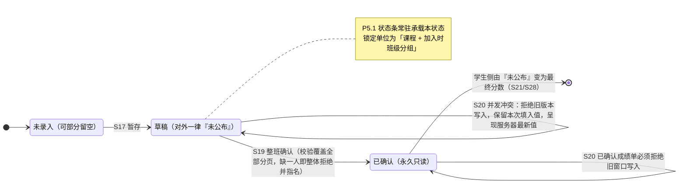

# 全局流程图（Mermaid）

> 数据源：`页面划分-方案与依据.md`（方案 A · 定稿版）、`用户故事主流程梳理.md`（F1—F7 + 横切 A/B）、《用户故事清单》S01a—S28。
> 覆盖故事：`S01a`、`S01b`、`S02—S22`、`S24—S28`。
> **不纳入**：`S23`（修改课程基础信息，Q01 待澄清、未批准）。
> 页面编号采用方案 A 定稿：独立路由 `P1—P7`（7 个），非独立外壳 `P0`、`P3.1`、`P3.2`、`P4.1`、`P5.1`（5 个）。

## 图例

| 线型         | 含义                             |
| ---------- | ------------------------------ |
| 实线 `-->`   | 正常业务流转；`↩ 返回` 表示**操作完成后的返回位置** |
| 点线 `-.->`  | 异常 / 拒绝 / 失效 / 未决分支            |
| 菱形 `{}`    | 服务端裁决点（角色判定、合法性判定）             |
| 六边形 `{{}}` | 上下文载体（非界面，靠 P0 常驻维持）           |

---

## 图 1 · 全局流程图（主图）

```mermaid
%% =====================================================================
%% 全局流程图 · 页面划分方案 A + 用户故事 S01a—S28
%% 图例：实线=正常流转与"完成后返回"  点线=异常/拒绝/失效/未决
%% 不纳入：S23（Q01 待澄清）
%% =====================================================================
flowchart TD

%% ---------------- 公共层 ----------------
subgraph PUB["公共层 · 未登录"]
  START(["访问任意受保护地址<br/>未登录 / 登录已过期"])
  P1["P1 登录（独立路由）<br/>S01a 校验凭据 · S01b 角色分流"]
  LFAIL["登录页就地提示<br/>凭据错误 / 已过期"]
  ROLE{"由服务端判定角色<br/>BR01：页面不自称身份"}
end

START --> P1
P1 -->|"提交凭据"| ROLE
ROLE -.->|"凭据无效"| LFAIL
LFAIL -->|"重新填写"| P1
ROLE -->|"角色 = 教师"| SHELL_T
ROLE -->|"角色 = 学生"| SHELL_S
ROLE -.->|"无有效身份"| LFAIL

%% ---------------- 教师层 ----------------
subgraph TEACH["教师层 · P0 常驻壳下的并列入口"]
  SHELL_T["P0 全局导航壳（非独立外壳 · 常驻）<br/>身份 · 角色导航 · S02 退出<br/>当前课程指示器 + 无权限/失效提示位"]
  P2["P2 我的课程（独立路由）<br/>S10 列表 · S11 创建 · S12 删空课程<br/>承担显式『进入课程』"]
  P3["P3 共享目录（独立路由）· S03<br/>搜索 / 分页：加载中 · 空结果 · 失败 三态"]
  P31["P3.1 班级视图（非独立外壳）<br/>S04 新建 · S05 重命名 · S06 条件删除"]
  P32["P3.2 学生视图（非独立外壳）<br/>S07 添加（档案+账号整体成功/回滚）<br/>S08 改资料 · 转班 · S09 条件删除"]
  P4["P4 课程成员（独立路由）<br/>S15 移除成员"]
  P41["P4.1 选人面板（非独立外壳 · 抽屉）<br/>S13 按班批量 · S14 单人加入"]
  P5["P5 成绩录入（独立路由）<br/>S16 读取 · S17 暂存 · S18 清空"]
  P51["P5.1 成绩单状态条（非独立外壳 · 常驻）<br/>S20 草稿/已确认 · 版本 · 冲突提示"]
  P6["P6 确认与统计（独立路由）<br/>S19 整班确认 · S22 三项统计"]
  CTX{{"当前课程上下文<br/>P0 指示器 + ?course=xxx（刷新不丢）"}}
end

%% —— 并列入口（同一层级的五个任务页） ——
SHELL_T -->|"并列入口"| P2
SHELL_T -->|"并列入口"| P3
SHELL_T -->|"并列入口"| P4
SHELL_T -->|"并列入口"| P5
SHELL_T -->|"并列入口"| P6
SHELL_T -->|"S02 退出"| OUT

%% —— 我的课程：进入课程 = 写入课程上下文 ——
P2 -->|"显式『进入课程』"| CTX
CTX -->|"课程内并列入口"| P4
CTX -->|"课程内并列入口"| P5
CTX -->|"课程内并列入口"| P6
P2 -->|"S11 创建课程 · 模态完成 ↩ 返回 P2，新课程即当前课程"| P2
P2 -->|"S12 删除空课程 · 模态完成 ↩ 返回 P2，列表刷新"| P2

%% —— 共享目录：先选班级，再看/改该班学生 ——
P3 -->|"切换视图"| P31
P3 -->|"切换视图"| P32
P31 -->|"选定班级后进入该班学生"| P32
P32 -->|"返回班级列表 ↩ 回到 P3.1（保留已选班级）"| P31
P31 -->|"S04/S05/S06 模态完成 ↩ 返回 P3.1，班级列表刷新"| P31
P32 -->|"S07/S08/S09 模态完成 ↩ 返回 P3.2"| P32

%% —— 课程成员：选人抽屉 ——
P4 -->|"打开选人面板"| P41
P41 -->|"S13/S14 提交完成 ↩ 关闭抽屉回 P4，反馈新增/跳过/被拒人数"| P4
P4 -->|"S15 移除完成 ↩ 停留 P4，分组快照刷新"| P4

%% —— 成绩录入：草稿态反复续接 ——
P5 -->|"常驻状态条"| P51
P5 -->|"S16 读取完成 ↩ 停留 P5"| P5
P5 -->|"S17 暂存成功 ↩ 停留 P5，状态条刷新版本/最后保存时间"| P5
P5 -->|"S18 清空成功 ↩ 停留 P5（清空 ≠ 填 0）"| P5

%% —— 确认与统计：状态翻转点 ——
P6 -->|"S19 整班确认（校验覆盖全部分页，缺一人即整体拒绝并指名）↩ 停留 P6，本分组永久只读"| P6
P6 -->|"S22 三项统计（总人数/未录入/不及格）↩ 停留 P6"| P6
P6 -->|"确认后回写只读态"| P5
P5 -->|"确认前复核全部分页"| P6

%% ---------------- 学生层 ----------------
subgraph STU["学生层 · P0 常驻壳下"]
  SHELL_S["P0 全局导航壳（学生）<br/>身份 · S02 退出 · 提示位"]
  P7["P7 我的成绩（独立路由）<br/>S21 本人已确认成绩 · S28 全部已加入课程状态"]
end

SHELL_S -->|"并列入口（学生仅此一个任务页）"| P7
P7 -->|"S21/S28 查询完成 ↩ 停留 P7"| P7
SHELL_S -->|"S02 退出"| OUT

%% ---------------- 退出返回 ----------------
OUT["S02 退出：清除本地身份<br/>（退出 ≠ 远端会话立即失效）"]
OUT -->|"再次访问受保护地址须重新登录"| P1

%% ---------------- 横切 A：异常与失效（全部去向） ----------------
subgraph EXC["横切 A · 服务端裁决 + P0 统一提示位"]
  E_SESS["C1/C2 未登录 · 登录已过期<br/>去向 → 拒绝并跳转 P1"]
  E_ROLE["C3 角色越权（学生请求教师功能）<br/>去向 → 服务端拒绝，退回本人角色首任务页"]
  E_OWN["C4 归属越权（请求非本人课程）<br/>去向 → 拒绝且不返回任何对方数据<br/>P0 提示『无权限访问该课程数据』→ 返回 P2"]
  E_STU["C5 学生数据越权（查他人 / 篡改学号 / 改分）<br/>去向 → 服务端拒绝，不返回他人分数"]
  E_FAKE["C6 伪造身份 / 伪造归属<br/>去向 → 以凭据为准，拒绝且不据此建课"]
  E_404["C7 资源不存在（班级已删 / 目标班不存在 / 学生已不存在 / 课程不属于本人）<br/>去向 → 提示『不存在 / 无权限』，与『空结果』严格区分"]
end

SHELL_T -.->|"服务端校验 C1/C2"| E_SESS
SHELL_T -.->|"服务端校验 C3"| E_ROLE
SHELL_T -.->|"服务端校验 C4"| E_OWN
SHELL_T -.->|"服务端校验 C6"| E_FAKE
SHELL_T -.->|"服务端校验 C7"| E_404
P1 -.->|"服务端校验 C6（页面自称教师）"| E_FAKE
P7 -.->|"服务端校验 C5"| E_STU

E_SESS -->|"去向"| P1
E_ROLE -->|"去向：教师"| P2
E_ROLE -->|"去向：学生"| P7
E_OWN -->|"去向"| P2
E_STU -->|"去向"| P7
E_FAKE -->|"去向"| P2
E_404 -->|"去向"| P3
E_404 -->|"去向"| P4
E_404 -->|"去向"| P7

%% ---------------- 横切 B：页面基础状态 ----------------
subgraph EXCB["横切 B · 三态必须互相区分"]
  ST_LOAD["D1 加载中"]
  ST_EMPTY["D2 空结果"]
  ST_FAIL["D3 失败 → 失败 + 重试入口<br/>写入失败保留教师刚填的输入"]
end

P3 -.->|"三态"| ST_LOAD
P3 -.->|"三态"| ST_EMPTY
P2 -.->|"D2 本人无课程"| ST_EMPTY
P5 -.->|"D3 暂存 / 确认失败"| ST_FAIL
P7 -.->|"D2 无课程 ≟ 未公布"| ST_EMPTY
ST_FAIL -->|"原地重试"| P5

%% ---------------- 未决分支 ----------------
Q04["Q04 未决 · 成绩单锁定后能否新增成员<br/>决定前不得声称该边界已通过（S24 挂起）"]
P41 -.->|"S24 分组已锁定时的加入结果"| Q04

%% ---------------- 样式 ----------------
classDef pub fill:#E6F1FB,stroke:#185FA5,color:#0C447C
classDef tch fill:#E1F5EE,stroke:#0F6E56,color:#085041
classDef stu fill:#FAEEDA,stroke:#BA7517,color:#633806
classDef exc fill:#FCEBEB,stroke:#A32D2D,color:#501313
classDef ret fill:#F1EFE8,stroke:#5F5E5A,color:#2C2C2A
class START,P1,ROLE,LFAIL pub
class SHELL_T,P2,P3,P31,P32,P4,P41,P5,P51,P6,CTX tch
class SHELL_S,P7,OUT stu
class E_SESS,E_ROLE,E_OWN,E_STU,E_FAKE,E_404,ST_LOAD,ST_EMPTY,ST_FAIL exc
class Q04 ret
```

---

## 图 2 · 状态主轴与并发（S20 的落点）

---

## 一、操作完成后的返回位置（逐条对齐）

| 操作（故事）          | 发生位置      | 完成后返回位置                          | 返回时页面必须显示                        |
| --------------- | --------- | -------------------------------- | -------------------------------- |
| S01a / S01b 登录  | P1        | 教师 → **P2**；学生 → **P7**（均经 P0 壳） | 按服务端判定角色分流                       |
| S02 退出          | P0        | **P1**（清除本地身份后再次访问须重新登录）         | 退出 ≠ 远端会话立即失效                    |
| S10 查看本人课程      | P2        | **停留 P2**                        | 三态就地（加载中 / 空结果 / 失败）             |
| S11 创建课程        | P2（模态）    | **返回 P2**，新课程即当前课程               | 列表刷新                             |
| S12 删除空课程       | P2（模态）    | **返回 P2**                        | 列表刷新；成员数 ≠ 0 时被拒绝                |
| 进入课程            | P2        | 写入当前课程上下文 → 进入 **P4 / P5 / P6**  | P0 指示器显示当前课程                     |
| S03 目录查询        | P3        | **停留 P3**                        | 空结果 ≠ 失败 ≠ 无权限                   |
| S04 / S05 / S06 | P3.1（模态）  | **返回 P3.1**                      | 班级列表刷新；删除被拒时提示"存在关联"             |
| S07 / S08 / S09 | P3.2（模态）  | **返回 P3.2**                      | S07 一次性教学初始凭据在模态内展示（关闭后可见性待定）    |
| S13 / S14 选人    | P4.1（抽屉）  | **关闭抽屉回 P4**                     | 反馈"新增 N / 跳过 M / 被拒 K（并指出哪个分组）"  |
| S15 移除成员        | P4        | **停留 P4**                        | 分组快照刷新；无草稿且未锁定时才允许               |
| S16 读取成绩单       | P5        | **停留 P5**                        | 按加入时班级分组呈现                       |
| S17 暂存          | P5        | **停留 P5**                        | P5.1 刷新版本与最后保存时间；分页中未触及行保持原值     |
| S18 清空          | P5        | **停留 P5**                        | 清空 ≠ 填 0                         |
| S20 并发冲突        | P5 / P5.1 | **停留 P5**                        | 拒绝旧版本 → 保留本次填入值 → 呈现服务器最新值再决定    |
| S19 整班确认        | P6        | **停留 P6**                        | 本分组永久只读；P5 同步只读                  |
| S22 三项统计        | P6        | **停留 P6**                        | 总人数 / 未录入 / 不及格，随成员增减保持一致        |
| S21 / S28 学生查询  | P7        | **停留 P7**                        | 未公布 / 无课程 / 最终分数（0 显示 0.0）三态文字区分 |

**两条通用返回纪律**：

1. **模态与抽屉一律"原路返回"**——它们不是独立路由，关闭后回到宿主视图，且宿主视图必须已刷新（不能停留在旧数据上）。
2. **平级任务页之间的返回靠 P0 导航**——P2—P6 无父子关系，不设"上一级"，教师随时可经 P0 切到另一个任务页，课程上下文由指示器保持。

---

## 二、异常分支去向总表（横切 A）

| 编号  | 情形                      | 触发位置                               | 去向（返回位置）                                   |
| --- | ----------------------- | ---------------------------------- | ------------------------------------------ |
| C1  | 未登录                     | 任一受保护请求                            | 拒绝 → **P1**                                |
| C2  | 登录已过期                   | 请求时凭据已失效                           | 拒绝 → **P1**                                |
| C3  | 角色越权（学生请求教师功能）          | P2 / P3 / P4 / P5 / P6             | 服务端拒绝 → **教师回 P2、学生回 P7**                  |
| C4  | 归属越权（请求非本人课程）           | P2 / P4 / P5 / P6                  | 拒绝且不返回任何对方数据，P0 提示"无权限访问该课程数据" → **返回 P2** |
| C5  | 学生数据越权（查他人 / 篡改学号 / 改分） | P7                                 | 服务端拒绝且不返回他人分数 → **停留 P7**                  |
| C6  | 伪造身份 / 伪造归属             | P1（页面自称教师）、P2（伪造归属建课）              | 以凭据为准，拒绝且不据此建课 → **P2 / 回登录**              |
| C7  | 资源不存在                   | P3（班级已删、目标班不存在）、P4（学生已不存在）、P7（无课程） | 提示"不存在 / 无权限"，**与"空结果"严格区分** → 返回原发起入口     |

**横切 B（三态）去向**：`D1 加载中` 原地等待；`D2 空结果` 原地显示"空"；`D3 失败` 显示失败 + 重试入口（**写入失败保留教师刚填的输入**），重试后原地回到同一读写入口——三者与"无权限"两两可辨。

---

## 三、这张图如何满足四项硬要求

| 要求              | 在图中的体现                                                                                                    |
| --------------- | --------------------------------------------------------------------------------------------------------- |
| **登录后按角色身份分流**  | `ROLE{"由服务端判定角色（BR01）"}` 一个裁决点分叉出 `SHELL_T` / `SHELL_S` 两条；分流依据是服务端判定，页面不自称身份；`S01a` 通过前的任何请求都落到 `E_SESS` |
| **并列入口**        | 两层：① P0 壳直连 **P2 / P3 / P4 / P5 / P6** 五个平级任务页；② 写入当前课程上下文后，**P4 / P5 / P6** 三个课程内任务页并列                   |
| **操作完成后退出返回位置** | 所有模态 / 抽屉 / 读写的出边都标注 `↩ 返回`，并在第一节列成对照表；退出统一走 `S02 → OUT → P1`                                             |
| **全部异常分支去向**    | 横切 A 的 C1—C7 各有"触发 → 去向"出边并落到具体页面；横切 B 的 D1—D3 挂到三个共享读取入口；`S24 / Q04` 未决分支单独图示，不得当作已定                     |

---

## 四、需要注意的两点

1. **`S24 / Q04` 是图中唯一的"未决分支"**——它挂在 `P4.1` 上，指向 `Q04` 而不是任何页面。在 Q04 决定前，这条分支不得改画成"加入成功"或"一律拒绝"。
2. **`P3.1 ⇄ P3.2` 是页内视图切换，不是路由跳转**——图中画出双向边仅为表达"先选班级 → 再看/改该班学生"的单一上下文；原型上二者共用 P3 的一个 URL。
